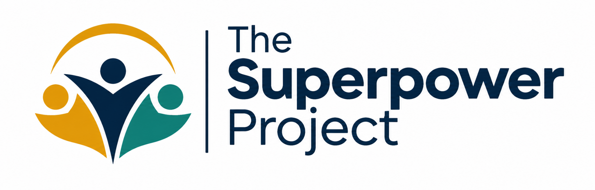

<div align="center">



### CARE QUALITY COMMISSION (CQC) SINGLE ASSESSMENT FRAMEWORK (SAF)
**B2B Care Provider Regulatory Compliance & Evidentiary Mapping Dossier**  
*Dual-Mapped against the Health and Social Care Act 2008 (Regulated Activities) Regulations 2014 & NICE Guideline NG97*

---

| DOCUMENT CONTROL & CLASSIFICATION | SPECIFICATION METADATA |
| :--- | :--- |
| **Document Reference Code** | `SPP-CQC-2026-SAF-MAT` |
| **Version Control** | Version 6.0 (Post-Single Assessment Framework Final Standard) |
| **Effective Date** | 1 January 2026 |
| **Review Cycle** | Continuous Regulatory Synchronization (Quarterly Cycle) |
| **Senior Responsible Owner (SRO)** | Director of Regulatory Affairs & Former CQC Specialist Advisor |
| **Target Distribution** | Registered Managers, Nominated Individuals, Regional Quality Directors, CQC Inspectors |
| **Protective Marking** | **COMMERCIAL-IN-CONFIDENCE // AUDIT-READY CARE PACK** |

---

</div>

## SECTION 1.0: REGULATORY ARCHITECTURE & STATUTORY DUAL-MAPPING

**1.1.** This Evidence Matrix provides Registered Managers, Nominated Individuals, Regional Directors, and Quality Assurance Inspectors with an authoritative, cross-mapped compliance reference demonstrating how deployment of The Superpower Project’s life-story and cognitive engagement architecture generates immediate, defensible regulatory evidence.

**1.2.** This Matrix establishes a dual-mapped compliance bridge linking:
* The five Care Quality Commission (CQC) **Key Questions**: *Safe, Effective, Caring, Responsive, and Well-Led*;
* The CQC **Single Assessment Framework (SAF) Quality Statements**; and
* The statutory requirements of the **Health and Social Care Act 2008 (Regulated Activities) Regulations 2014**.

```
+----------------------------------------------------------------------------------------------------+
|                         CQC SINGLE ASSESSMENT FRAMEWORK (SAF) DUAL-MAPPING                         |
+---------------------+-----------------------------------+------------------------------------------+
| CQC KEY QUESTION    | SAF QUALITY STATEMENTS            | STATUTORY REGULATIONS (2014)             |
+---------------------+-----------------------------------+------------------------------------------+
| 1. SAFE             | - Learning culture                | Regulation 12 (Safe care and treatment)  |
|                     | - Safe systems, pathways and flow | Regulation 13 (Safeguarding service      |
|                     | - Involving people to manage risk |               users from abuse)          |
|                     | - Safe environments               | Regulation 15 (Premises and equipment)   |
+---------------------+-----------------------------------+------------------------------------------+
| 2. EFFECTIVE        | - Assessing needs                 | Regulation 9 (Person-centred care)       |
|                     | - Delivering evidence-based care  | Regulation 11 (Need for consent)         |
|                     | - How staff work together         | Regulation 14 (Meeting nutritional and   |
|                     | - Supporting people to live well  |               hydration needs)           |
+---------------------+-----------------------------------+------------------------------------------+
| 3. CARING           | - Kindness, compassion & dignity  | Regulation 10 (Dignity and respect)      |
|                     | - Treating people as individuals  |                                          |
|                     | - Independence, choice and control|                                          |
|                     | - Responding to immediate needs   |                                          |
+---------------------+-----------------------------------+------------------------------------------+
| 4. RESPONSIVE       | - Person-centred care             | Regulation 9 (Person-centred care)       |
|                     | - Care provision, integration     |                                          |
|                     | - Providing information           |                                          |
|                     | - Equity in access and outcomes   |                                          |
+---------------------+-----------------------------------+------------------------------------------+
| 5. WELL-LED         | - Shared direction and culture    | Regulation 17 (Good governance)          |
|                     | - Capable, compassionate leaders  | Regulation 18 (Staffing)                 |
|                     | - Governance and assurance        | Regulation 20 (Duty of candour)          |
|                     | - Continuous learning/improvement |                                          |
+---------------------+-----------------------------------+------------------------------------------+
```

***

## SECTION 2.0: FIVE-AXIS EVIDENCE SUBSTANTIATION & AUDIT MATRICES

---

### AXIS 1: SAFE
**Statutory Anchor:** *Health and Social Care Act 2008 (Regulated Activities) Regulations 2014: Regulation 12 (Safe Care and Treatment) & Regulation 13 (Safeguarding Service Users from Abuse and Improper Treatment).*

#### Mapped Single Assessment Framework Quality Statements
* *SAF Safe: Involving people to manage risks*
* *SAF Safe: Safe environments*
* *SAF Safe: Safe and effective staff*
* *SAF Safe: Safeguarding*

#### Operational Methodology & Technical Protocols
1. **Clinical Risk Mitigation in Cognitive Vulnerability:** Sessions operate under strict non-confrontational, non-clinical protocols designed to avoid memory-testing anxiety. Deployed facilitators are trained to de-escalate cognitive distress, agitation, or confusion without resorting to physical intervention or chemical sedation.
2. **Infection Prevention & Control (IPC) Compliance:** All facilitator-transported apparatus (recording devices, heirloom display materials) undergo pre- and post-entry sanitization in accordance with the *Health and Social Care Act 2008: Code of Practice on the prevention and control of infections*. Hand sanitization and appropriate PPE (conforming to ongoing UKHSA social care guidance) are enforced across every residential floor.
3. **Environmental and Acoustic Safety:** Acoustic footprints are held below 55 decibels to prevent auditory hyper-reactivity in sensory-vulnerable dementia residents. Physical cabling is eliminated from resident contact zones via self-contained battery units, removing trip hazards and equipment collisions.

#### Evidentiary Output Generated for Registered Managers
* **Pre-Deployment Clinical Risk Matrix:** Individual risk-stratification records for each participant, identifying historical triggers, trauma boundaries, and communication requirements.
* **IPC Sanitization Verification Logs:** Documented equipment sanitation sign-offs appended to the home's primary Health & Safety audit binder.
* **Safeguarding Observation Memos:** Contemporaneous records confirming zero safeguarding breaches, with immediate written notifications regarding any observed signs of pressure ulcers, unexplained bruising, or distress.

---

### AXIS 2: EFFECTIVE
**Statutory Anchor:** *Health and Social Care Act 2008 (Regulated Activities) Regulations 2014: Regulation 9 (Person-Centred Care), Regulation 11 (Need for Consent).*

#### Mapped Single Assessment Framework Quality Statements
* *SAF Effective: Delivering evidence-based care & treatment*
* *SAF Effective: How staff work together*
* *SAF Effective: Supporting people to live healthier lives*
* *SAF Effective: Assessing needs*

#### Operational Methodology & Technical Protocols
1. **Alignment with NICE Guideline NG97:** The intervention is structured to operationalize Recommendation 1.4.1 of *NICE Guideline NG97 (Dementia: assessment, management and support for people living with dementia)*, which mandates structured group or individualized reminiscence therapy to promote wellbeing, cognitive stimulation, and social integration.
2. **Cognitive Activation & Life-Story Methodology:** Utilizing multimodal, multi-sensory prompt architecture (including period-accurate music cues, historical olfactory prompts, and targeted geographic imagery), the program activates retrograde autobiographical memory networks, counteracting the progressive communicative decline caused by neurological degeneration.
3. **Mood, Lucid State, and Engagement Baseline Tracking:** Facilitators employ the validated *Bradford Dementia Group Wellbeing Profiling System* to record pre-session, intra-session, and post-session affect indicators, tracking quantifiable improvements in verbal fluency, eye contact, and emotional equilibrium.

#### Evidentiary Output Generated for Registered Managers
* **Biographical Cognitive Profile:** A clinical summary of the resident’s preserved memory strengths, effective conversational prompts, and communication strategies, provided to the care home's clinical team to enrich individual Care Plans.
* **Objective Engagement Logs:** Quantitative indices documenting sustained attention spans, conversational exchanges, and emotional wellbeing markers for evidence during CQC inspections.
* **Validated Statutory Consent Instruments:** Full audit trail under MCA 2005 (Tier-1, Tier-2 LPA verification, or Tier-3 Best-Interests decision forms).

---

### AXIS 3: CARING
**Statutory Anchor:** *Health and Social Care Act 2008 (Regulated Activities) Regulations 2014: Regulation 10 (Dignity and Respect).*

#### Mapped Single Assessment Framework Quality Statements
* *SAF Caring: Kindness, compassion and dignity*
* *SAF Caring: Treating people as individuals*
* *SAF Caring: Independence, choice and control*
* *SAF Caring: Responding to immediate needs*

#### Operational Methodology & Technical Protocols
1. **Identity Affirmation and Biographical Validation:** The intervention counters "institutional depersonalization" by treating the resident as an autonomous individual with a rich lifetime history, rather than merely a recipient of personal care tasks. Facilitators focus exclusively on the resident’s profession, passions, creative achievements, and identity.
2. **Combatting Social Isolation and Anhedonia:** Through dedicated, unhurried 1-to-1 narrative engagement, the intervention directly mitigates chronic loneliness and social withdrawal in residential care, offering empathetic human connection tailored to the individual's communication pace.
3. **Empowering Autonomy and Self-Expression:** The resident exercises absolute sovereignty over their narrative. They determine which stories are captured, which images are included, and how their life is preserved, directly reinforcing personal autonomy and control within an institutional setting.

#### Evidentiary Output Generated for Registered Managers
* **Qualitative Dignity Case Dossiers:** Narrative case studies highlighting individual personal histories, cultural identities, and personal achievements, which can be presented directly to CQC inspectors as evidence of dignity-led care.
* **Family & Next-of-Kin Impact Appraisals:** Structured feedback gathered from relatives evaluating the program's impact on their loved one's emotional wellbeing and the preservation of family relationships.
* **Resident Autonomy Audit Statements:** Documented instances where residents exercised personal choice, narrative consent, and creative direction during their sessions.

---

### AXIS 4: RESPONSIVE
**Statutory Anchor:** *Health and Social Care Act 2008 (Regulated Activities) Regulations 2014: Regulation 9 (Person-Centred Care) & The Equality Act 2010.*

#### Mapped Single Assessment Framework Quality Statements
* *SAF Responsive: Person-centred care*
* *SAF Responsive: Care provision, integration and continuity*
* *SAF Responsive: Providing information*
* *SAF Responsive: Equity in access and outcomes*

#### Operational Methodology & Technical Protocols
1. **Sensory and Physical Impairment Adaptation:** The program adapts to individual sensory needs:
   * *Aural Adaptation:* Bone-conduction listening devices and frequency-equalized acoustic amplification for residents with hearing loss;
   * *Visual Adaptation:* High-contrast large-type printed proofing formats (minimum 18pt font) and tactile embossing for residents with macular degeneration or visual impairments;
   * *Physical Frailty:* Ergonomically supported recording setups for bedbound, fatigued, or palliative residents.
2. **Bedside 1-to-1 Palliative Integration:** For individuals confined to bed or in late-stage palliative care, the operational architecture shifts from standard sessions to bedside presence. Facilitators use gentle auditory stimulation, family voice recordings, and low-energy conversation to provide comforting, dignified engagement.
3. **Multilingual and Culturally Sensitive Personalization:** Facilitators adapt interview frameworks to the cultural, national, and religious identities of participants, incorporating culturally relevant historical events, mother-tongue idioms, and heritage-specific traditions to ensure equitable care delivery across diverse populations.

#### Evidentiary Output Generated for Registered Managers
* **Bespoke Environmental & Sensory Adjustment Logs:** Detailed records documenting individual physical accommodations, communication adjustments, and tailored engagement strategies.
* **Bedside & Palliative Inclusion Records:** Quantitative logs demonstrating that bedbound, high-acuity residents receive equal access to meaningful cognitive and psychosocial activities, preventing exclusion.
* **Cultural Competence Alignment Dossiers:** Evidence demonstrating person-centred care tailored to the protected characteristics of individual residents under the *Equality Act 2010*.

---

### AXIS 5: WELL-LED
**Statutory Anchor:** *Health and Social Care Act 2008 (Regulated Activities) Regulations 2014: Regulation 17 (Good Governance) & Regulation 18 (Staffing).*

#### Mapped Single Assessment Framework Quality Statements
* *SAF Well-Led: Shared direction and culture*
* *SAF Well-Led: Capable, compassionate and inclusive leaders*
* *SAF Well-Led: Governance, management and sustainability*
* *SAF Well-Led: Learning, improvement and innovation*

#### Operational Methodology & Technical Protocols
1. **Turnkey Workforce Integration (Zero-Burden Staffing):** The deployment requires zero staffing allocations from the care home’s care rotas. Superpower Project Facilitators handle all logistics, safeguarding compliance, family coordination, and narrative production independently, enabling staff to focus on clinical and personal care duties.
2. **Governance Integration & Clinical Safety Compliance:** The operating model operates under strict clinical governance standards (DCB0129/DCB0160 principles), clear risk management plans, high-level corporate insurances (£5M Public/Products Liability, £5M Professional Indemnity), and verified Enhanced DBS checks.
3. **Continuous Quality Improvement (CQI) Loop:** Feedback loops integrate post-session observations directly into the home’s quality management system. Changes in resident cognitive state, emotional needs, or nutritional/fluid preferences mentioned during sessions are immediately communicated to management.

#### Evidentiary Output Generated for Registered Managers
* **Post-Session Audit-Ready Inspection Pack:** A consolidated regulatory dossier delivered within 24 hours of session completion, comprising:
  * Quantitative session logs and attendance records;
  * Qualitative resident impact case summaries;
  * Mapped compliance briefs cross-referenced to CQC Quality Statements;
  * Validated consent and MCA capacity records.
* **CQC Inspector Briefing Sheets:** Executive one-page summaries designed to be handed directly to CQC assessment teams during unannounced inspections, providing empirical evidence of innovative, person-centred care under Regulation 17.
* **Workforce Efficiency & Capacity Reports:** Documented hours of high-tier psychosocial engagement delivered to residents with zero allocation of internal care staff hours, evidencing effective resource optimization under Regulation 18.

***

<div align="center">

---

### CQC REGULATORY AUDIT ATTESTATION FOOTER

**THE SUPERPOWER PROJECT LTD: QUALITY & REGULATORY GOVERNANCE DIRECTORATE**  
*Corporate Head Office: 124 City Road, London, EC1V 2NX, United Kingdom*  
*Registered in England & Wales • Company No. 15482091 • ICO Registration No. ZB684920*

| INSPECTION COMPLIANCE BENCHMARK | AUDIT EVIDENCE STATUS |
| :--- | :--- |
| **Regulation 9 (Person-Centred Care)** | Corroborated via Form B-02 Consent & Form C-03 Affect Profiles |
| **Regulation 11 (Need for Consent)** | 100% MCA 2005 Validated (Tiers 1, 2 LPA, or 3 Best Interests) |
| **Regulation 12 & 13 (Safe Care & Safeguarding)** | Enhanced DBS Cleared Facilitators • Form A-01 Risk Audits • £5M Liability |
| **Regulation 17 & 18 (Governance & Staffing)** | Turnkey Zero-Rota Extraction • 24hr Audit Pack Delivery to Registered Manager |

*Regulatory Evidence Matrix. © 2026 The Superpower Project Ltd. Prepared for UK Registered Care Providers.*

---

</div>
