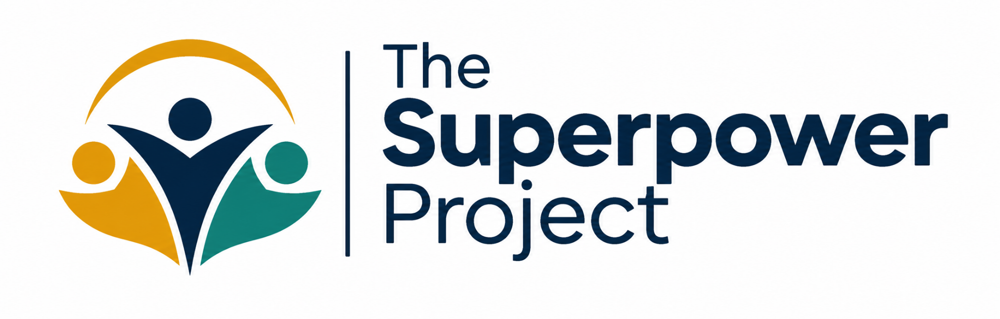

<div align="center">



# THE SUPERPOWER PROJECT LTD & IACSID
### MASTER INSTITUTIONAL GOVERNANCE, CLINICAL ETHICS & REGULATORY COMPLIANCE SYSTEM
**Executive Faculty Suites & Standing Standards Secretariat: 124 City Road, London, EC1V 2NX, United Kingdom**  
*Incorporated under the Companies Act 2006 (England & Wales No. 15482091) • ICO Data Protection Register: ZB684920*

---

| MASTER GOVERNANCE BENCHMARK | ASSURANCE SUMMARY |
| :--- | :--- |
| **Protective Marking** | **PUBLIC ENTERPRISE RECORD // TIER-1 REGULATORY COMPLIANCE** |
| **Effective Release** | Version 8.4 — Annual Statutory & Institutional Standard (2026/2027) |
| **Statutory Alignment** | Care Act 2014 • Health & Social Care Act 2008 Regs 2014 • Mental Capacity Act 2005 • UK GDPR |
| **Clinical Safety Framework** | NHS Digital DCB0129/DCB0160 Principles • Caldicott Principles • NICE Guideline NG97 |
| **Vetting & Liability Cover** | Enhanced DBS with Adult Barred List Checks • £5M Public Liability • £5M Professional Indemnity |

---

</div>

## 🏛️ Comprehensive Institutional Document Suite (7 Core Volumes)

This repository constitutes the definitive, production-ready institutional and regulatory governance architecture for **The Superpower Project Ltd** and its executive training arm, **The Institute for Applied Commercial Systems & Institutional Diplomacy (IACSID)**.

```
+----------------------------------------------------------------------------------------------------+
|                         THE SUPERPOWER PROJECT INSTITUTIONAL SYSTEM TOPOLOGY                       |
+----------------------------------------------------------------------------------------------------+
| [VOLUME 1: ACCREDITATIONS & HONORS]        [VOLUME 2: EXECUTIVE CPD SYLLABUS]                      |
| Document 1: SPP-REG-2026-001-A             Document 2: IAC-PROS-2026-FCIIS-L7                      |
| The National Register of Honors &          IACSID Executive Prospectus &                           |
| 4-Stage Governance Audit Rubric            Fellowship Specification (FCIIS - Level 7)              |
+--------------------------------------------+-------------------------------------------------------+
| [VOLUME 3: CLINICAL ETHICS & PRIVACY]      [VOLUME 4: REGULATORY EVIDENCE]                         |
| Document 3: SPP-ETH-2026-V8-PROT           Document 4: SPP-CQC-2026-SAF-MAT                       |
| Safeguarding, MCA 2005 Consent &           CQC Single Assessment Framework (SAF) Dual-             |
| Zero-Retention Data Sovereignty Protocol   Mapped Evidence Matrix (5 Key Questions)                |
+--------------------------------------------+-------------------------------------------------------+
| [VOLUME 5: CARE PARTNER RECOGNITION]       [VOLUME 6: CONSTITUTION & ADVISORY]                     |
| Document 5: SPP-SSB-2026-AWD-001           Document 6: SPP-GOV-2026-CHARTER-002                    |
| Superpower Standards Board (SSB) Care      Standing Governance Charter, S.172 Duties &             |
| Partner Recognition & Quality Scheme       Clinical & Ethical Advisory Panel (CEAP) Terms          |
+--------------------------------------------+-------------------------------------------------------+
| [VOLUME 7: FIELD OPERATIONAL FORMS]                                                                |
| Document 7: SPP-CQC-2026-FORM-KIT                                                                  |
| Audit-Ready Inspection Pack (Forms A-01, B-02 Consent, C-03 Wellbeing Affect Scale, D-04 Briefing) |
+----------------------------------------------------------------------------------------------------+
```

***

### Master Document Directory & Technical Summaries

| Volume | Document File | Reference Code | Primary Regulatory & Governance Purpose |
| :---: | :--- | :--- | :--- |
| **01** | [**DOCUMENT_1_NATIONAL_REGISTER_OF_HONORS.md**](./DOCUMENT_1_NATIONAL_REGISTER_OF_HONORS.md) | `SPP-REG-2026-001-A` | **National Register of Institutional Honors:** Inscribes validated distinctions (`UK-NR-2026-8841-CARE`, `UK-NR-2026-9024-CQC-SAF`, and `UK-NR-2026-1107-NSQLS`) with citations and the 4-Stage Governance Audit Rubric (Clinical Safety, Technological Invisibility, Neurological Engagement Efficacy, Zero-Burden Staff Integration). |
| **02** | [**DOCUMENT_2_IACSID_EXECUTIVE_PROSPECTUS.md**](./DOCUMENT_2_IACSID_EXECUTIVE_PROSPECTUS.md) | `IAC-PROS-2026-FCIIS-L7` | **Executive Prospectus & Level 7 CPD Syllabus:** Concluding in the post-nominal **Fellow in Commercial Integration & Institutional Strategy (FCIIS)** across 4 accredited modules: `IAC-701` (Sovereign Governance), `IAC-702` (Care Commissioning & ICB Economics), `IAC-703` (Civic Diplomacy & APPG Integration), and `IAC-704` (Non-Dilutive Capital & Innovate UK Grant Engineering). |
| **03** | [**DOCUMENT_3_SAFEGUARDING_CLINICAL_ETHICS_DATA_SOVEREIGNTY.md**](./DOCUMENT_3_SAFEGUARDING_CLINICAL_ETHICS_DATA_SOVEREIGNTY.md) | `SPP-ETH-2026-V8-PROT` | **Safeguarding, Clinical Ethics & Data Sovereignty Protocol:** Formal statutory clauses (1.0 to 6.0) codifying the "Human-First, Tech-Invisible" hardware air-gap, Mental Capacity Act 2005 Tripartite Consent Decision Tree, Eight Caldicott Principles, UK GDPR Arts 6 & 9 Special Category handling, Zero-Retention AI pipeline, Section 42 Rapid Escalation Tree, and CDPA 1988 copyright assignment. |
| **04** | [**DOCUMENT_4_CQC_SINGLE_ASSESSMENT_EVIDENCE_MATRIX.md**](./DOCUMENT_4_CQC_SINGLE_ASSESSMENT_EVIDENCE_MATRIX.md) | `SPP-CQC-2026-SAF-MAT` | **CQC Single Assessment Framework (SAF) Evidence Matrix:** Dual-mapped compliance matrix cross-referencing all 5 CQC Key Questions (*Safe, Effective, Caring, Responsive, Well-Led*), modernized CQC Quality Statements, and Health and Social Care Act 2008 (Regulated Activities) Regulations 2014 (Regs 9, 10, 11, 12, 13, 17, and 18). |
| **05** | [**DOCUMENT_5_CARE_PARTNER_AWARDS_SCHEME.md**](./DOCUMENT_5_CARE_PARTNER_AWARDS_SCHEME.md) | `SPP-SSB-2026-AWD-001` | **The Superpower Standards Board (SSB) Care Partner Recognition Scheme:** Transparent, proprietary quality distinction program recognizing client care homes, registered managers, and frontline carers (*The National Senior Quality-of-Life Seal NSQLS-A1* and *Care Practitioner of the Year in Cognitive Storytelling*). |
| **06** | [**DOCUMENT_6_GOVERNANCE_CHARTER_AND_ETHICS_PANEL.md**](./DOCUMENT_6_GOVERNANCE_CHARTER_AND_ETHICS_PANEL.md) | `SPP-GOV-2026-CHARTER-002` | **Standing Governance Charter & Ethics Panel (CEAP) Terms of Reference:** Companies Act 2006 Section 172 stakeholder obligations, Seven Nolan Principles, Clinical Safety Officer (DCB0129) veto powers over software, Caldicott Guardian oversight, conflict-of-interest registers, and Public Interest Disclosure Act 1998 whistleblower protections. |
| **07** | [**DOCUMENT_7_CQC_INSPECTION_PACK_TEMPLATES.md**](./DOCUMENT_7_CQC_INSPECTION_PACK_TEMPLATES.md) | `SPP-CQC-2026-FORM-KIT` | **CQC Audit-Ready Field Inspection Pack:** Complete administrative and clinical production instruments: **Form A-01** (IPC & Environmental Safety Risk Audit), **Form B-02** (MCA 2005 Statutory Consent & Best-Interests Determination), **Form C-03** (Bradford Wellbeing Affect Scale), and **Form D-04** (Regulation 17 CQC Inspector Statutory Briefing Sheet). |

***

## 🛡️ Statutory, Clinical & Data Protection Mandates

All operations, clinical engagements, and enterprise software pipelines deployed by The Superpower Project Ltd operate under continuous synchronization with:

1. **Adult Safeguarding & Duty of Care:**
   * *The Care Act 2014:* Section 1 (Wellbeing Principle), Section 42 (Safeguarding Inquiries), and Section 67 (Advocacy).
   * *Safeguarding Vulnerable Groups Act 2006 (amended by Protection of Freedoms Act 2012):* 100% Enhanced DBS with Adult Barred List checks.
2. **Mental Capacity & Autonomy:**
   * *Mental Capacity Act 2005:* Sections 1 to 4 functional capacity evaluations and multi-disciplinary Best-Interests determinations.
   * *Human Rights Act 1998:* Article 8 (Right to respect for private and family life).
3. **Data Protection & Clinical Information Governance:**
   * *UK General Data Protection Regulation (UK GDPR) & Data Protection Act 2018 (DPA 2018):* Articles 6(1)(a)/(f) and 9(2)(a)/(h) special category health data exclusions.
   * *The Eight Caldicott Principles:* Justified purpose, minimum necessary data, and duty to share safely.
   * *Zero-Retention AI Architecture:* Complete contractual prohibition on utilizing resident memoirs, voice recordings, or likenesses for third-party machine learning model training.
4. **Care Quality Commission (CQC) Single Assessment Alignment:**
   * *Health and Social Care Act 2008 (Regulated Activities) Regulations 2014:* Regulation 9 (Person-Centred Care), Regulation 10 (Dignity & Respect), Regulation 11 (Need for Consent), Regulation 12 (Safe Care & Treatment), Regulation 13 (Safeguarding), Regulation 17 (Good Governance), and Regulation 18 (Staffing).
   * *NICE Guideline NG97 (Dementia):* Structured reminiscence and life-story work for cognitive stimulation.

***

<div align="center">

---

### INSTITUTIONAL ATTESTATION & CORPORATE DIRECTORY

**THE SUPERPOWER PROJECT LTD**  
*Corporate Headquarters: 124 City Road, London, EC1V 2NX, United Kingdom*  
*Registered in England & Wales • Company No. 15482091 • ICO Registration No. ZB684920*

| ASSURANCE DIMENSION | STATUTORY VERIFICATION & UNDERWRITING |
| :--- | :--- |
| **Corporate Liability Underwriter** | £5,000,000 Public Liability • £5,000,000 Professional Indemnity • £2,000,000 Cyber |
| **Vetting & Barring Scheme** | Enhanced DBS with Adult Barred List Continuous Verification (DBS Update Service) |
| **Clinical Safety Directorate** | Certified DCB0129 / DCB0160 Clinical Risk Management Infrastructure |
| **Information Governance** | Designated Caldicott Guardian & Nominated Data Protection Officer (ICO ZB684920) |

*The Superpower Project Ltd & IACSID Master System Index. © 2026 All Rights Reserved.*

---

</div>
